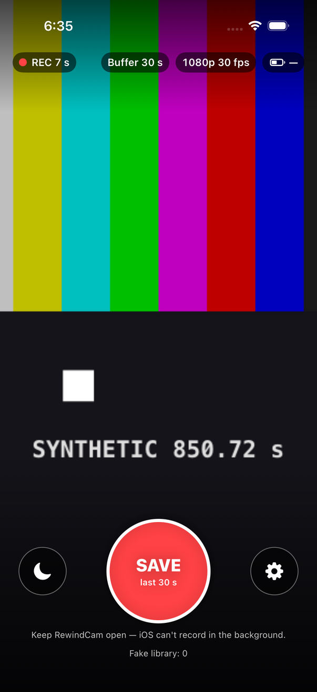
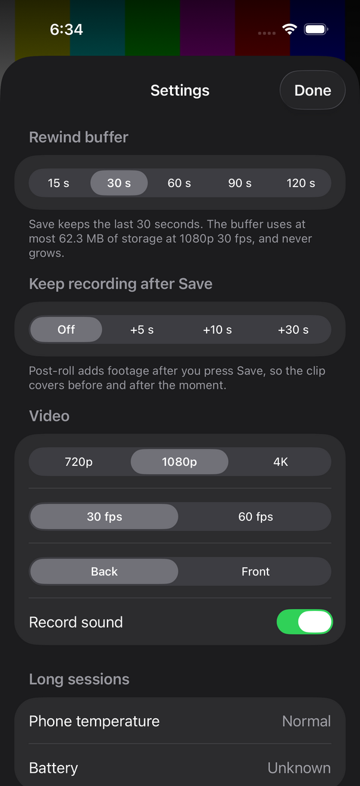

# RewindCam

[](https://github.com/esdu/app1/actions/workflows/ios.yml)

A free, private, offline **pre-record camera** for catching a baby's spontaneous milestones: first
steps, first words, the laugh you didn't see coming.

The camera records all the time into a rolling buffer that never grows. When something happens,
tap **Save** (or press a volume button, or say "save that") and the last *N* seconds land in Photos.
Nothing leaves the phone: there is no network code, no accounts and no analytics.

| Recording | Saved | Settings | Dimmed |
|---|---|---|---|
|  |  |  |  |

*Screenshots come from the UI tests in the Simulator. The colour bars are the synthetic test
source, because the Simulator has no camera.*

## Features

- **Rolling buffer** of 15, 30, 60, 90 or 120 s. Disk use is bounded: only the buffer plus a small margin
  is ever stored (see the [disk math](DESIGN.md#bounded-disk)).
- **Save** with a big on-screen button, or the **volume buttons** (`AVCaptureEventInteraction`, iOS 17.2+).
- **Post-roll**: keep recording 0, 5, 10 or 30 s after the trigger, so the clip covers before *and* after.
- **Photos** with add-only permission (asked at launch, not during the first save), a confirmation
  toast and a haptic.
- **No lost clips**: a saved clip is kept in the app (Application Support, excluded from backup) until
  Photos accepts it. If Photos access is denied or the import fails, a banner says so and offers
  **Retry**, also after a relaunch. Export and import keep running for a while if you lock the phone
  right after tapping Save (background task).
- **Quality**: 720p, 1080p, or 4K where the camera supports it; 30 or 60 fps; sound on or off; front or back camera.
- **Microphone denied**: recording carries on without sound. A banner says sound is off (and that
  the voice trigger can't listen, if it is on) because microphone access is denied, with an
  **Open Settings** button. "Record sound" stays as you set it, and sound comes back once access is allowed.
- **Long sessions**: the screen stays awake. A **Dim** overlay drops brightness to 2 % and
  you tap to wake. The app watches thermal state and steps quality down (and tells you) when the
  phone gets hot. Battery level is shown.
- **Interruptions** (calls, another app taking the camera, backgrounding) pause cleanly and clear
  the buffer, and capture resumes on its own when the app comes back.
- **Orphan cleanup**: leftover buffer files and half-written exports from a crash or kill are removed
  on launch. Finished clips that didn't reach Photos are kept.
- **Voice trigger** (optional, off by default): say "save that". Recognition is **on-device
  only** (`requiresOnDeviceRecognition`). The app also measures battery drain per hour so you can
  see what the voice trigger costs.

## How it works

One `AVAssetWriter` with the `.mpeg4AppleHLS` profile cuts the stream into ~1 s fragmented-MP4
segments. They are kept in a ring on disk (`Caches/`), and the oldest are deleted once the buffer is
covered. On Save, the init segment and the retained segments are concatenated, trimmed to the exact
range with `AVMutableComposition`, and exported **without re-encoding** (passthrough) to `.mov`.
Full details, threading and buffer math are in **[DESIGN.md](DESIGN.md)**.

## Known limits

- **No background recording.** iOS doesn't let apps use the camera in the background. When
  RewindCam leaves the screen the buffer is cleared, and the app says so. Keep it open, with
  Dim on for long sessions.
- **Real-camera behaviour is not verified in CI.** CI runs on the Simulator, which has no camera,
  no volume buttons, no thermal changes and no battery. Everything except `CameraFrameSource`,
  `AVCaptureEventInteraction`, real Photos and the speech recogniser is tested through the
  synthetic source and fakes. See the manual checklist below.
- Changing a video setting, or a thermal step-down, **restarts the writer and clears the buffer**
  (segments from different encoder settings can't be joined without re-encoding).
- A Save resolves when the segment containing the tap is complete, about 1 s after the tap
  (plus any post-roll). The clip still ends exactly at the tap.
- Only one save can be pending at a time. A second tap during post-roll says "Already saving".
- **Clips that didn't reach Photos** take their full size in the app's storage until a Retry succeeds.
  There is no in-app way to delete or share them yet; allow Photos access and tap Retry.
  (A small in-app list for them is proposed in [docs/decisions/clip-library.md](docs/decisions/clip-library.md).)
- **Clips that didn't reach Photos are not backed up** and don't move to a new or restored phone: they
  are excluded from iCloud/device backup until Photos has them. All media files use the iOS default
  Data Protection class ("available after first unlock"), set explicitly so a save can finish while the
  phone is locked; the stricter "Complete" class would make it fail. See DESIGN.md §2, "File protection
  and backup". The Simulator doesn't enforce Data Protection, so this is checked on a device only.
- A save is only safe once its export has finished (a few seconds after the tap, plus post-roll). If
  iOS kills the app before that (for example after a long time locked), that one clip is lost. If it
  is killed after Photos accepted a clip but before the app noticed, Retry can add it twice.
- Background time for finishing a save, the real Photos permission prompt and Photos import errors
  are not verified on a device yet.
- The voice trigger is English (en-US) and needs a device that supports on-device recognition.
- With the microphone denied, clips have no sound track at all. The microphone paths of
  `CameraFrameSource` (denied prompt, a mic input that can't be added) are not verified on a device yet;
  CI simulates the denial with the synthetic source.
- UI tests run the synthetic source at 360×640 (the CI VM has no hardware encoder). Unit tests use
  320×180 at 15 fps so 300 s of footage encodes in seconds.

## Install on a real iPhone

You need a Mac with Xcode 26 or newer and an iPhone on iOS 17.2 or newer. A free Apple ID works
(apps signed with a free account expire after 7 days).

1. Install XcodeGen and generate the project:

   ```bash
   brew install xcodegen
   ```

   ```bash
   git clone https://github.com/esdu/app1.git && cd app1 && xcodegen generate
   ```

2. Open `RewindCam.xcodeproj`. Select the **RewindCam** target, then **Signing & Capabilities**:
   pick your **Team**, and if Xcode says the identifier is taken, change the **Bundle Identifier**
   (e.g. `com.yourname.rewindcam`).
3. Connect the iPhone and trust the Mac. On the phone, turn on
   **Settings › Privacy & Security › Developer Mode** and restart when asked.
4. Choose your iPhone as the run destination and press **Run** (⌘R).
5. On the phone, allow the developer under **Settings › General › VPN & Device Management** the first time.
6. Grant Camera and Microphone on first launch, then Photos (add-only), which is asked right after.

Command-line alternative (after `xcodegen generate`):

```bash
xcodebuild -project RewindCam.xcodeproj -scheme RewindCam -destination 'generic/platform=iOS' -allowProvisioningUpdates DEVELOPMENT_TEAM=YOURTEAMID PRODUCT_BUNDLE_IDENTIFIER=com.yourname.rewindcam build
```

## Manual test checklist (real device)

- [ ] **Volume buttons**: with the camera running, press volume up and then volume down. Each saves one
      clip, and the system volume HUD does not appear.
- [ ] **Clip contents**: a clip saved after 60 s with a 30 s buffer plays in Photos, lasts about 30 s,
      ends at the moment of the tap, is upright, and has sound (and none with "Record sound" off).
- [ ] **Post-roll**: with +10 s, the toast says "recording 10 s more" and the clip lasts about 40 s.
- [ ] **Front camera**: the clip is upright and mirrored like the preview.
- [ ] **4K / 60 fps**: offered only where supported, and clips play back smoothly.
- [ ] **Interruptions**: during a phone call, from Camera.app opened via Control Center, and with the
      app backgrounded and reopened, the banner explains, the buffer restarts, and no broken clip is saved.
- [ ] **Thermal**: warm the phone (4K60, in the sun, while charging). At "serious" the orange banner shows
      and the preset label drops; when the phone cools it returns to your setting.
- [ ] **2-hour session**: Dim on, unplugged. Recording is still running after 2 h, the screen never
      locked, Save still works, and storage in Settings › General › iPhone Storage › RewindCam does not grow.
- [ ] **Battery drain per hour**: run 1 h unplugged with voice off, then 1 h with voice on. Read
      the "Measured battery drain" row in Settings each time and note both %/h figures.
- [ ] **Voice trigger**: "save that" saves a clip from about 2 m away; normal chatter doesn't.
- [ ] **Orphans**: force-quit while recording, relaunch, and the app's storage drops back to about the buffer size.
- [ ] **Photos denied, then retry**: on a fresh install, choose "Don't Allow" at the Photos prompt. An
      orange banner explains it. Tap Save: the toast says the clip is kept, and the banner says
      "1 clip isn't in Photos yet". Force-quit and relaunch: the banner is still there. Allow
      Photos in Settings › RewindCam › Photos, tap **Retry**: the clip appears in Photos, plays fully,
      and the banner goes away.
- [ ] **Microphone denied with "Record sound" on**: on a fresh install, allow the camera and choose
      "Don't Allow" at the microphone prompt. Recording starts, the buffer counter climbs, and an orange
      "Sound is off" banner says microphone access is denied. Save after 30 s: the clip plays, has no
      sound, and is about as long as the buffer. In Settings, "Record sound" is still on. With the voice
      trigger on, its "Listening" row says the microphone is denied. Tap **Open Settings**: RewindCam's
      page opens. Allow the microphone and return (iOS may relaunch the app): the banner is gone and the
      next clip has sound.
- [ ] **Lock during save**: with +10 s post-roll, tap Save and lock the phone at once. After 30 s,
      unlock: the clip is in Photos (or, if not, offered for Retry), never silently gone.
- [ ] **Locked export (file protection)**: at 4K60 with a 120 s buffer and +30 s post-roll, record
      2 min, tap Save and lock the phone at once (passcode set, "Require Passcode: Immediately"). After
      2 min, unlock: the clip is in Photos or offered for Retry, never "Export failed". Repeat with Photos
      denied: lock, wait, unlock, relaunch: the kept clip is still offered and Retry adds it, and it plays.

## Development

- `project.yml` → `xcodegen generate` (never edit the `.pbxproj` by hand).
- Swift 6 (strict concurrency), SwiftUI, AVFoundation; minimum iOS 17.2.
- `-UITestMode` launch argument: synthetic camera, fake photo library in `Documents/FakePhotoLibrary`,
  fresh settings, no kept clips. Add `-UITestPhotosFailOnce` to make the first Photos save fail, or
  `-UITestDenyMicrophone` to make the synthetic source behave as if microphone access were denied.
- CI ([`.github/workflows/ios.yml`](.github/workflows/ios.yml)): newest macOS runner and newest
  Xcode, iPhone simulator picked dynamically, `xcodebuild test`, then the unit tests four more times as a
  flake check. Per-test timeouts are on (180 s default, 300 s maximum), so a hung test fails by name
  instead of running into the 30-minute job timeout. The `.xcresult` bundle, screenshots, a summary,
  `xcodebuild.log`, `stress.log` and the app's simulator log (`simulator.log`) are always uploaded.
  Screenshots are also published to the hidden git ref `refs/ci/screenshots` (`git fetch origin refs/ci/screenshots`).
- Privacy manifest ([`RewindCam/Resources/PrivacyInfo.xcprivacy`](RewindCam/Resources/PrivacyInfo.xcprivacy)):
  no tracking, no collected data; declares the required-reason APIs the app uses (`UserDefaults`
  `CA92.1`, disk space `E174.1`). A unit test checks it is in the built app bundle.

## Task checklist

- [x] DESIGN.md: architecture and buffer math
- [x] Minimal green pipeline (XcodeGen, macOS 26 runner, newest Xcode, dynamic simulator, artifacts)
- [x] Rolling buffer engine: HLS-profile fMP4 segments, ring eviction, bounded disk
- [x] Save: concatenate → trim → passthrough `.mov`; early save; post-roll
- [x] Interruptions: buffer resets cleanly, no corrupt clips
- [x] Thermal step-down policy
- [x] Settings persistence
- [x] App model + SwiftUI UI (Save button, toast, haptic, settings, dim mode, battery)
- [x] Volume buttons via `AVCaptureEventInteraction` (needs a real device to verify)
- [x] UI tests with screenshots (`-UITestMode`)
- [x] Orphan cleanup on launch
- [x] Final README: screenshots, limits, device install
- [x] Stretch: on-device voice trigger ("save that") behind a setting, with measured battery drain

## License

MIT — see [LICENSE](LICENSE).
