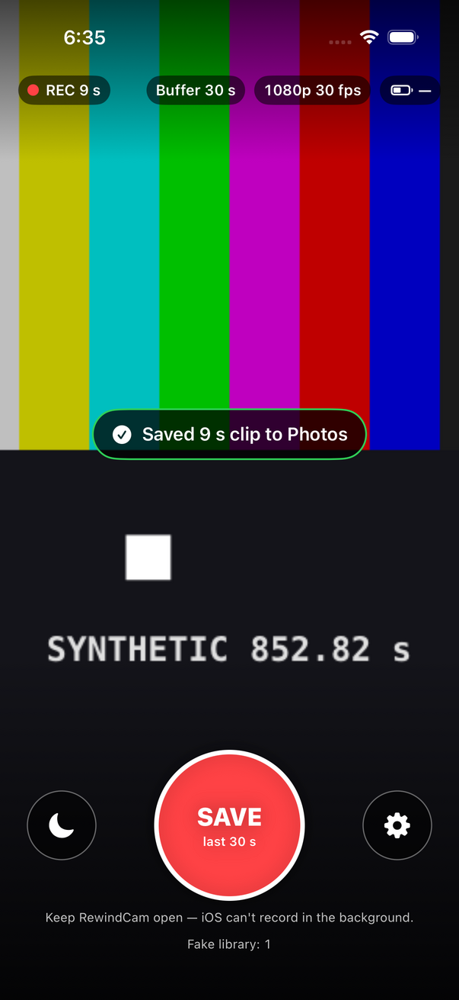
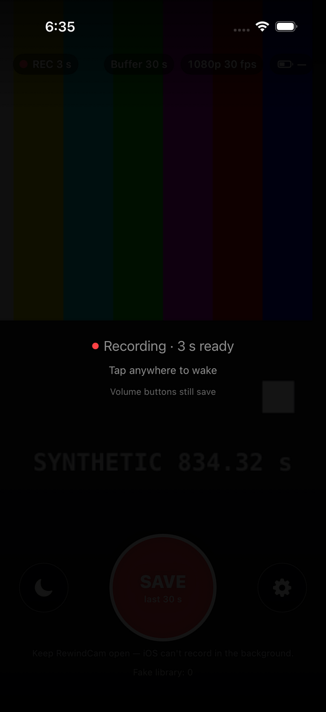

# RewindCam

[](https://github.com/esdu/app1/actions/workflows/ios.yml)

A free, private, offline **pre-record camera** for catching a baby's spontaneous milestones: first
steps, first words, the laugh you didn't see coming.

The camera records all the time into a rolling buffer that never grows. When something happens,
tap **Save** (or press a volume button, or say "save that") and the last *N* seconds land in Photos.
Nothing leaves the phone: there is no network code, no accounts and no analytics.

**RewindCam is a camera, not a baby monitor, and doesn't replace supervising your child.**

| Recording | Saved | Settings | Dimmed |
|---|---|---|---|
|  |  |  |  |

*Screenshots come from the UI tests in the Simulator. The colour bars are the synthetic test
source, because the Simulator has no camera.*

## Features

**Recording and saving**

- **Rolling buffer** of 15, 30, 60, 90 or 120 s. Disk use is bounded: only the buffer plus a small margin
  is ever stored (see the [disk math](DESIGN.md#bounded-disk)).
- **Save** with a big on-screen button, the **volume buttons** (`AVCaptureEventInteraction`, iOS 17.2+),
  or the optional **voice trigger** (below). The clip ends at the moment of the trigger (plus any
  post-roll).
- **Post-roll**: keep recording 0, 5, 10 or 30 s after the trigger, so the clip covers before *and* after.
- **Photos** with add-only permission (asked right after the camera starts, not during the first save),
  a confirmation toast and a haptic.
- **Quality**: 720p, 1080p, or 4K where the camera supports it; 30 or 60 fps; sound on or off; front or
  back camera.
- **No lost clips**: a saved clip is kept in the app (Application Support, excluded from backup) until
  Photos accepts it. If Photos access is denied or the import fails, a banner says "1 clip isn't in
  Photos yet" and offers **Retry**, also after a relaunch. Export and import keep running for a while if
  you lock the phone or leave the app right after tapping Save (background task), and every media file
  uses the "available after first unlock" protection class, so a save can finish while the phone is locked.
- **Voice trigger** (optional, off by default): say "save that" (or "save this"). Recognition is
  **on-device only** (`requiresOnDeviceRecognition`). The app measures battery drain per hour, so you
  can see what the voice trigger costs. If speech recognition keeps failing, it retries for about 30 s,
  then stops: a toast says "The voice trigger stopped: speech recognition isn't available." and the
  "Listening" row says "No — speech recognition isn't available". It tries again the next time recording
  starts or resumes, or when you turn it off and on.

**Long sessions**

- The screen stays awake while recording. **Dim** drops brightness to 2 % under a black overlay; recording
  continues, the volume buttons still save, and you tap anywhere to wake. Battery level is shown.
- **Thermal step-down**: when the phone gets hot, RewindCam lowers the quality and says so ("Phone is
  hot — recording at 720p 30 fps until it cools down."); your setting comes back when it cools.
- **Pause / Resume**: RewindCam starts recording on launch and resumes on its own, but you can tap
  **Pause** (above Save) to turn the camera off. If footage is buffered it asks first, because pausing
  discards the unsaved buffer; clips you saved, and clips waiting for Photos, are kept. While paused the
  badge says PAUSED, a blue banner explains it, Save, the volume buttons and the voice trigger refuse
  (and say why), Dim is off and the screen may lock. The pause holds when you leave the app and come back,
  after a trip to Settings, and through camera errors or interruptions ending, until you tap **Resume**.

**When something goes wrong, it says so**

- **Interruptions** (calls, another app taking the camera, backgrounding) pause cleanly and clear
  the buffer, and capture resumes on its own when the app comes back.
- **Camera denied**: a red "Camera access is off" banner says why RewindCam needs the camera, with an
  **Open Settings** button; nothing is recorded and Save is disabled (it says why). If the camera
  can't start for another reason (no camera, configuration failed), the banner offers **Try Again**.
  The app checks again whenever it comes back to the foreground, so allowing the camera in Settings
  and returning starts recording without a relaunch. Settings and the unsaved-clips Retry keep working.
- **Microphone denied**: recording carries on without sound. An orange banner says sound is off (and
  that the voice trigger can't listen, if it is on) because microphone access is denied, with an
  **Open Settings** button. "Record sound" stays as you set it, and sound comes back once access is allowed.
- **Camera errors recover or stop**: after a capture-session error the app restarts the camera
  (at once, then backing off for about 30 s). If that doesn't work it stops, wakes the screen from Dim
  and shows "Not recording" with **Try Again**, instead of claiming to restart forever. A status
  check every 0.5 s also resumes recording if the camera came back without telling the app.
- **Frame watchdog**: if no new video frame reaches the buffer for 5 s while the app says it is
  recording (sound still arriving doesn't count), or frames arrive but nothing is written for 5 s, it
  says so ("No new video for 5 s. Restarting the camera…") and restarts the camera once. If that
  brings recording back, an orange "The camera was restarted" banner says when, and that the footage
  from before is gone; if video stops again, it stops, wakes the screen from Dim and shows
  "Not recording" with **Try Again**. A save waiting for its post-roll is finished at once with the
  footage there is (the toast says the clip ends early), or fails with a message saying to save again.
- **Low-disk guard**: RewindCam checks free space before it starts buffering, every 5 s while it
  records, and when you tap Save. Without room for the buffer it doesn't start ("Not recording: not
  enough free space"), and says how much to free and where, or to choose a shorter buffer or lower
  quality (lowering either in Settings starts recording once it fits). If space runs low while recording
  it stops cleanly, before writes fail; when only a save might not fit it keeps recording and warns
  ("Storage is low"). A save is never refused for space, only warned about; it then takes what fits and
  says if it came out shorter. Settings shows free space and marks buffer lengths that don't fit.
  Clips waiting for Photos are never deleted to make room; the warnings say how much they take.
- **Bounded temporary video**: besides the ring, a save's working files and the fragments waiting to be
  written are capped. Settings shows "Temporary video: X of at most Y". If the phone can't store video as
  fast as it arrives, recording stops with "Not recording" and **Try Again** rather than growing.
- **Orphan cleanup**: leftover buffer files and half-written exports from a crash or kill are removed
  on launch. Finished clips that didn't reach Photos are kept.

**Accessibility and privacy**

- **Accessibility**: VoiceOver speaks every save result and state change (recording, paused, resumed,
  stopped, camera restarted, storage low, phone hot), once per change, also with the screen dimmed;
  while dimmed, the overlay has a **Save** action. The badge, pills, banners and controls read as
  sentences ("Recording, 12 seconds ready"), and Save says why it is unavailable. Text follows Dynamic
  Type up to the largest accessibility sizes: the status bar wraps to two rows, banners scroll instead
  of covering the Save row, and Settings swaps segmented controls for menus. Fixed shapes (status
  pills, round buttons, the Save circle) stop growing at an accessibility size and show the large
  content viewer on a long press. Banner and button text keeps at least 4.5:1 contrast over any
  footage, and the toast doesn't animate with Reduce Motion. See DESIGN.md §4, "Accessibility".
- **Privacy**: offline, no accounts, no analytics, add-only Photos access. The privacy manifest declares
  no tracking and no collected data.

## How it works

One `AVAssetWriter` with the `.mpeg4AppleHLS` profile cuts the stream into ~1 s fragmented-MP4
segments. They are kept in a ring on disk (`Caches/`), and the oldest are deleted once the buffer is
covered. On Save, the init segment and the retained segments are concatenated, trimmed to the exact
range with `AVMutableComposition`, and exported **without re-encoding** (passthrough) to `.mov`.
Full details, threading and buffer math are in **[DESIGN.md](DESIGN.md)**.

## Known limits

**By design**

- **No background recording.** iOS doesn't let apps use the camera in the background. When
  RewindCam leaves the screen the buffer is cleared, and the app says so. Keep it open, with
  Dim on for long sessions.
- **Some changes clear the buffer.** Changing resolution, frame rate, camera or "Record sound" (or turning
  the voice trigger on or off while "Record sound" is off), and a thermal step-down, restart the writer and
  clear the buffer: segments from different encoder settings can't be joined without re-encoding. A new
  buffer length or post-roll applies without a restart.
- **A save resolves about 1 s after the tap** (plus any post-roll), when the segment containing the tap
  is complete. The clip still ends exactly at the tap. If less than the buffer length has been recorded
  (for example just after launch), the clip is whatever exists.
- **One save at a time.** Until a save has finished (post-roll, export and the Photos import), another
  Save, volume-button press or voice trigger shows "Already saving — hold on…" and saves nothing.
- **A pause lasts until Resume or until RewindCam is relaunched**: it isn't saved, so a relaunch (also
  after iOS ends the app in the background) records again. While paused the camera session is off, so
  the volume buttons may change the volume instead of reaching RewindCam.
- **The frame watchdog** notices a stall 5 to 5.5 s after the last new frame; footage from before its
  restart is cleared like any other restart.
- **60 fps is offered at every resolution.** Where the camera has no 60 fps format at the chosen
  resolution, it captures at 30 fps while RewindCam still shows 60 fps.
- **With the microphone denied**, clips have no sound track at all.
- The voice trigger is English (en-US) and needs a device that supports on-device recognition.

**Clips that didn't reach Photos**

- They take their full size in the app's storage until a Retry succeeds. There is no in-app way to
  play, share or delete them yet; allow Photos access and tap **Retry**. (A small in-app list for them is
  proposed in [docs/decisions/clip-library.md](docs/decisions/clip-library.md).)
- They are **not backed up** and don't move to a new or restored phone: they are excluded from
  iCloud/device backup until Photos has them.
- All media files use the iOS default Data Protection class ("available after first unlock"), set
  explicitly so a save can finish while the phone is locked; the stricter "Complete" class would make it
  fail. The trade-off: once the phone has been unlocked after it was turned on, these files stay
  decryptable while it is locked.
  See DESIGN.md §2, "File protection and backup".
- **A save is only safe once its export has finished** (a few seconds after the tap, plus post-roll). If
  iOS kills the app before that (for example after a long time locked), that one clip is lost. If it
  is killed after Photos accepted a clip but before the app noticed, Retry can add it twice.

**Storage**

- **Free space is an estimate.** The low-disk guard compares free space with nominal sizes (DESIGN.md
  "Free space"); a save can still fail if VBR peaks or other apps use the space meanwhile. iOS's
  "available for important usage" figure includes purgeable space, so it can be higher than
  Settings › General › iPhone Storage shows.
- **Saves can come out shorter.** Besides the buffer, a save needs room for its copy of the footage and
  the export (at most about 190 MB at the defaults, 4.1 GB at 4K60 with a 120 s buffer and +30 s;
  Settings shows the current use). A save takes what fits above a 64 MB reserve while recording: with too
  little room it keeps the newest part and says "It's shorter than asked", or saves nothing and says how
  much to free. Clips waiting for Photos are never deleted to make room.
- **If video arrives faster than it can be stored** (more than about 8 s of writes behind, or a disk
  write fails), recording stops with "Not recording" and **Try Again** instead of using more memory or
  leaving a gap; a save in progress keeps what was recorded before.

**Not verified on a device yet**

Nothing has been run on a physical iPhone. CI runs on the Simulator, which has no camera, microphone,
volume buttons, thermal changes or battery, and doesn't enforce Data Protection; there the app runs on
the synthetic source and fakes. These are covered only by the [manual checklist](#manual-test-checklist-real-device):

- the real camera and microphone (`CameraFrameSource`): their permission prompts and denial paths,
  configuration failures, front-camera mirroring, 4K and 60 fps support, and sound/picture sync and
  segment joins in saved clips;
- the volume buttons (`AVCaptureEventInteraction`), also while paused or dimmed;
- whether a real `AVCaptureSession` behaves as modelled after a runtime error or a media-services reset,
  whether it ever stalls the way the frame watchdog expects, and whether a stop and start cures it;
- real Photos (permission prompt, denial, import errors) and background time for finishing a save after
  the phone locks;
- Data Protection while locked (the Simulator reads every file);
- free space on a really full phone, real write failures, and peak memory and storage at 4K60 (the
  bounds are tested with simulated slow and full storage);
- thermal step-down, battery drain and long sessions;
- the speech recogniser;
- real VoiceOver speech, the large content viewer and changing the text size while the app runs (CI runs
  the Xcode accessibility audit and the largest text size, screenshots `a11y-*`);
- the real camera permission prompt and real interruption timing around a pause.

UI tests run the synthetic source at 360×640 (the CI VM has no hardware encoder). Unit tests use
320×180 at 15 fps so 300 s of footage encodes in seconds.

## Install on a real iPhone

You need a Mac with Xcode 26 or newer and an iPhone on iOS 17.2 or newer. A free Apple ID works
(apps signed with a free account expire after 7 days).

1. Install XcodeGen and generate the project:

   ```bash
   brew install xcodegen
   ```

   ```bash
   git clone https://github.com/esdu/app1.git && cd app1 && xcodegen generate
   ```

2. Open `RewindCam.xcodeproj`. Select the **RewindCam** target, then **Signing & Capabilities**:
   pick your **Team**, and if Xcode says the identifier is taken, change the **Bundle Identifier**
   (e.g. `com.yourname.rewindcam`).
3. Connect the iPhone and trust the Mac. On the phone, turn on
   **Settings › Privacy & Security › Developer Mode** and restart when asked.
4. Choose your iPhone as the run destination and press **Run** (⌘R).
5. On the phone, allow the developer under **Settings › General › VPN & Device Management** the first time.
6. Grant Camera and Microphone on first launch, then Photos (add-only), which is asked right after.

Command-line alternative (after `xcodegen generate`):

```bash
xcodebuild -project RewindCam.xcodeproj -scheme RewindCam -destination 'generic/platform=iOS' -allowProvisioningUpdates DEVELOPMENT_TEAM=YOURTEAMID PRODUCT_BUNDLE_IDENTIFIER=com.yourname.rewindcam build
```

## Manual test checklist (real device)

This is the only check of what CI can't reach (see "Not verified on a device yet" above). **None of it
has been run yet**, so every box is unchecked. Each item says what to do and, after **Pass:**, what you
must see. Copy this section into an issue or a file for each run, fill in the record, tick what passes,
and for anything else write down what you saw and when.

### Record

| | |
|---|---|
| Device model (Settings › General › About › Model Name) | |
| iOS version (Settings › General › About › iOS Version) | |
| Commit SHA of the build (`git rev-parse --short HEAD`) | |
| Free space at the start (Settings › General › iPhone Storage) | |
| Date | |
| Build (Debug from Xcode's Run, or Release) and tester | |

### Before you start

- **Defaults**, unless an item says otherwise: buffer 30 s, post-roll Off, 1080p, 30 fps, back camera,
  "Record sound" on, voice trigger off. "RewindCam's Settings" is the sheet behind the gear button;
  "Settings ›" alone is the iOS Settings app.
- **Fresh install**: delete RewindCam (touch and hold its icon › Remove App › Delete App), then run it
  from Xcode again. This resets its Camera, Microphone, Photos and Speech Recognition permissions.
- **Leaving RewindCam clears the buffer** (Home Screen, another app, the iOS Settings app, locking the
  phone). That is expected; it restarts recording when you come back.
- **The badge** at the top left reads "REC N s" while recording, where N is how many seconds a Save
  would include (at most the buffer length).
- **Looking at a clip**: in Photos the clip's length shows while it plays, and swiping up shows its
  resolution and frame rate (on the Mac, QuickTime Player's Window › Show Movie Inspector shows them
  too). For frame-level checks, AirDrop it to the Mac: QuickTime Player steps one frame with the arrow
  keys, and iMovie shows the sound as a waveform under the frames.

### 1. Clip timing, sound and joins (clock and clap)

Set-up: a stopwatch that shows hundredths, running on a second phone or a computer screen, filling
about a third of the frame from about 1 m, with room for your hands to clap in view. Play music or a
steady tone in the room too: a click or gap at a segment join is easiest to hear over a continuous sound.

For each buffer length below: choose it in RewindCam's Settings, close Settings, and film the stopwatch
while clapping sharply every 3 to 5 s for **at least twice the buffer length** (the badge reaches
"REC N s" with N the buffer length, then keeps reading it). Pick a stopwatch reading in advance, tap
**Save** when the stopwatch shows it, and write down the reading. Wait for "Saved N s clip to Photos".
**Pass**, in the saved clip:

- **(a) End**: the last frame shows the stopwatch at the reading you tapped at, within about 0.3 s
  (your reaction time).
- **(b) Length**: it lasts the buffer length, ±1 s (0:15, 0:30, 1:00, 1:30, 2:00), and the toast said
  the same number of seconds.
- **(c) Sync**: every clap is heard on the frame where the hands meet: in iMovie each clap's spike in
  the waveform is within 2 frames of that frame, and at normal speed no clap sounds early or late.
- **(d) Joins**: nowhere in the clip, in particular not once a second where the 1 s segments join, is
  there a click, gap, repeated or frozen frame, or jump: the stopwatch digits advance smoothly when
  stepped frame by frame, and the music plays through without a break (listen with headphones).

- [ ] 15 s buffer. Tapped at ______, last frame ______, length ______. (a) (b) (c) (d) pass.
- [ ] 30 s buffer. Tapped at ______, last frame ______, length ______. (a) (b) (c) (d) pass.
- [ ] 60 s buffer. Tapped at ______, last frame ______, length ______. (a) (b) (c) (d) pass.
- [ ] 90 s buffer. Tapped at ______, last frame ______, length ______. (a) (b) (c) (d) pass.
- [ ] 120 s buffer. Tapped at ______, last frame ______, length ______. (a) (b) (c) (d) pass.
- [ ] **Before the buffer is full**: 30 s buffer. Go to the Home Screen and back (the buffer is
      cleared), and tap Save when the badge reads about "REC 10 s". **Pass:** the toast and the clip
      both say about 10 s (what the badge showed, ±1 s), not 30 s; (a), (c) and (d) hold.
- [ ] **With post-roll**: 30 s buffer, post-roll +10 s. After 60 s, tap Save at a chosen reading.
      **Pass:** the toast first says "Saving… recording 10 s more", then "Saved 40 s clip to Photos";
      the clip lasts 0:40 ±1 s and its last frame shows the tap reading plus 10 s; (c) and (d) hold.
      Repeat with +30 s: "Saved 60 s clip to Photos", 1:00 long, ending 30 s after the tap.

### 2. Repeated saves

- [ ] 30 s buffer, post-roll Off, filming the stopwatch. After 60 s, save five times in a row while
      recording continues: tap Save, wait for "Saved 30 s clip to Photos", note the stopwatch reading
      you tapped at, tap again. Use the Save button three times, then volume up, then volume down.
      (A tap before the toast appears shows "Already saving — hold on…"; that is correct, and it saves
      nothing.) **Pass:** Photos has exactly five new clips; each plays to the end and lasts 0:30;
      each ends at its own noted reading, not the previous one's; the badge stayed on "REC 30 s"
      throughout and never showed another state.

### 3. Permissions (each on a fresh install)

- [ ] **Camera denied** (#8): choose "Don't Allow" at the camera prompt. **Pass:** a red "Camera
      access is off" banner says RewindCam needs the camera to keep the last moments ready to save;
      the badge says OFF; Save is greyed out (VoiceOver reads why); a volume-button press saves nothing
      (the volume changes, or a "Can't save" toast appears); RewindCam's Settings still opens. Tap
      **Open Settings**: RewindCam's page in the Settings app opens. Allow the camera and return (iOS may relaunch the
      app): recording starts without relaunching by hand, the banner is gone, and Save works.
- [ ] **Microphone denied with "Record sound" on** (#3): allow the camera, choose "Don't Allow" at the
      microphone prompt. **Pass:** recording starts and the badge counts up; an orange "Sound is off"
      banner says microphone access is denied, so clips are saved without sound. Save after 30 s: the
      clip plays, has no sound, and lasts about 30 s. In RewindCam's Settings, "Record sound" is still
      on. Where the voice trigger is available, turn it on: its "Listening" row says "No — microphone
      access is denied" and the banner title becomes "Sound and the voice trigger are off". Tap
      **Open Settings**: RewindCam's page opens. Allow the microphone and return (iOS may relaunch the
      app): the banner is gone and the next clip has sound.
- [ ] **Photos denied, then Retry** (#1): allow camera and microphone, choose "Don't Allow" at the
      Photos prompt (it comes right after the camera starts, before any save). **Pass:** an orange
      banner says Photos access is off and saved clips stay in RewindCam. Tap Save after 30 s: the toast
      says "Not added to Photos. The clip is kept in RewindCam — tap Retry." and the banner says "1 clip
      isn't in Photos yet." with **Retry**. Force-quit and relaunch: the banner is still there. Allow
      Photos in Settings › RewindCam › Photos, return and tap **Retry**: the toast says "Saved 1 clip to
      Photos", the clip appears in Photos, plays fully, and the banner goes away.
- [ ] **Speech Recognition denied**: turn on "Say “save that” to save" in RewindCam's Settings and
      choose "Don't Allow" at the speech prompt. **Pass:** a toast says "Allow Speech Recognition in
      Settings to use the voice trigger."; recording and Save carry on; the "Listening" row says "No".

### 4. Interruptions, also during a save (#1, #13)

For the save items, count the clips in Photos first. **Pass** for each of them: back in RewindCam
within a minute, either the new clip is in Photos and plays to its end (it may end early, at the moment
RewindCam left the screen; if the toast is still up it says "It ends early: recording stopped before the
end you asked for."), or the "1 clip isn't in Photos yet." banner is there and **Retry** adds it. Never
a missing clip with no banner, and never "Export failed".

- [ ] **While recording**: during a phone call, from Camera.app opened via Control Center, and with the
      app sent to the background and reopened. **Pass:** a banner explains each pause (for example
      "Paused — another app is using the camera. The buffer was cleared."), the buffer starts again
      from 0 when it ends, recording resumes without a tap, and no broken clip is saved.
- [ ] **Lock right after Save** (post-roll Off): tap Save and press the side button at once. Unlock
      after 30 s. Pass as above.
- [ ] **Lock during post-roll**: post-roll +10 s; tap Save, lock at once, unlock after 30 s. Pass as above.
- [ ] **Call right after Save**: post-roll +10 s; have someone call the phone; tap Save just as it
      rings, answer, talk for 10 s, hang up and return to RewindCam. Pass as above.
- [ ] **App switch during post-roll**: post-roll +10 s; tap Save and swipe up to the Home Screen (or
      switch to another app) at once; return after 30 s. Pass as above.
- [ ] **Locked export at the highest setting** (#13): set a passcode (Require Passcode: Immediately).
      4K (if offered), 60 fps, 120 s
      buffer, +30 s post-roll; record 2 min, tap Save and lock at once. After 2 min, unlock. Pass as
      above, and the clip plays to its end.
- [ ] **Interrupted saves with Photos denied**: with Photos access off (Settings › RewindCam › Photos:
      None), repeat "Lock during post-roll", then force-quit and relaunch. **Pass:** the banner says
      "1 clip isn't in Photos yet."; allow Photos and tap **Retry**: the clip is added and plays.

### 5. Recording controls

- [ ] **Volume buttons**: while recording, press volume up, wait for the toast, then volume down.
      **Pass:** each press saves one clip, and the system volume indicator does not appear.
- [ ] **Front camera**: switch to Front in RewindCam's Settings and save a clip. **Pass:** it is upright
      and mirrored like the preview.
- [ ] **Quality**: 4K is offered only where the camera supports it. Save a clip at each of 720p, 1080p and
      (if offered) 4K, at 30 and at 60 fps. **Pass:** each plays smoothly, and Photos' info shows the
      chosen resolution and frame rate (note any 60 fps setting that comes out at 30 fps; see Known
      limits). With "Record sound" off, the clip has no sound.
- [ ] **Dim**: tap the moon. **Pass:** the screen goes nearly black and shows "Recording · N s ready",
      "Tap anywhere to wake" and "Volume buttons still save"; the counter keeps climbing; a volume-button
      press saves a clip without waking the screen; a tap wakes it and the brightness comes back.
- [ ] **Thermal**: warm the phone (4K at 60 fps, in the sun, while charging). **Pass:** when RewindCam's
      Settings shows "Phone temperature: Hot", an orange "Phone is hot — recording at … until it cools
      down." banner shows and the quality pill drops; when it shows Normal or Warm again, the banner
      goes away and the pill returns to your setting.
- [ ] **Pause / Resume** (#15): record 10 s, tap **Pause**: it asks "Pause recording?" before
      discarding the buffer; tap "Pause and discard buffer". **Pass:** the green camera indicator goes
      off, the badge says PAUSED, a blue "Paused: the camera is off" banner explains, Save is greyed
      out, Dim is disabled, and the screen locks after the usual Auto-Lock time. A volume-button press
      saves nothing (the volume changes, or a "Can't save" toast appears). Switch to another app and
      back, and open RewindCam's Settings and close it: still paused. With Camera.app opened from
      Control Center while paused, closing it doesn't start RewindCam. Tap **Resume**: REC returns and
      Save works. Force-quit while paused and relaunch: it records (the pause isn't kept).
- [ ] **Pause around start-up** (#15): on a fresh install, go to the Home Screen while the camera
      prompt is up, come back and allow it. **Pass:** recording starts once, with no "Camera access is
      off" flash. Then force-quit, relaunch, and tap Pause while the badge still says STARTING:
      **Pass:** it stays paused, with no camera indicator.

### 6. Recovery (#4, #9)

- [ ] **Camera taken or reset while dimmed** (#4): record with Dim on. (1) Open Camera.app from
      Control Center, take a photo, close it. **Pass:** RewindCam's banner says another app is using
      the camera, and recording resumes on its own (the counter climbs again) without waking the
      screen. (2) Reset media services (Settings › Developer › Reset Media Services, where the
      Developer menu offers it) while RewindCam is open and dimmed. **Pass:** within a few seconds it
      is recording again, or, if the camera can't restart within about 30 s, the screen wakes and shows
      "Not recording" with **Try Again**, which starts recording. It never stays on "Camera error …
      Restarting…" with the counter at 0 s.
- [ ] **Frame watchdog** (#9): hard to provoke on purpose; watch for it in the soak and in the reset
      above. Once the buffer is full the counter stays at the buffer length, so it can't show a freeze:
      the check is a clip. **Pass:** a clip saved with a clock in view always ends at the time you
      tapped (the video wasn't frozen). If video does stop, within about 5 s the banner says "No new
      video for 5 s. Restarting the camera…", and then RewindCam either records again (an orange
      "The camera was restarted" banner with the time) or wakes the screen with "Not recording" and
      **Try Again**. A save made meanwhile ends with a clip (the toast says it ends early) or a message,
      never a toast stuck on "Saving…".

### 7. Storage (#10, #14)

- [ ] **Nearly full phone** (#10): fill the phone until under 200 MB is free (for example by recording
      4K video in Camera.app) and launch RewindCam with the default settings. **Pass:** a red "Not
      recording: not enough free space" banner says how much to free, Save is greyed out, and no write
      error appears. RewindCam's Settings shows the free space and marks 30 s as not fitting; choose
      15 s and 720p: recording starts (with an orange "Storage is low" banner if a save may not fit).
      Save once: the clip is saved, or the toast says why not, never silently. Then, while recording,
      fill the phone further: within about 5 s of free space falling under 64 MB, recording stops with
      the red banner. Free some space and tap **Try Again** (or leave and return): recording starts.
      Clips waiting for Photos are never deleted.
- [ ] **Working set at the highest setting** (#14): 4K (if offered) at 60 fps, 120 s buffer, +30 s
      post-roll; record 3 min and save twice (the second after the first has finished). **Pass:**
      RewindCam's Settings › "Temporary video" stays under its "at most" figure and returns to about the
      buffer size after each save; with Xcode's memory gauge attached, memory stays flat during saves
      (no growth by tens of MB per second). Repeat on a nearly full phone (under 1 GB free): the save
      succeeds, comes out shorter with "It's shorter than asked", or says how much to free; recording
      never fails with a write error, and clips waiting for Photos are still there.
- [ ] **Orphans**: post-roll +30 s. Tap Save, and during the post-roll force-quit RewindCam (swipe it
      away in the app switcher); that clip may be lost, a known limit. Relaunch and let the badge reach
      "REC 30 s". **Pass:** RewindCam's Settings › "Temporary video" is about the buffer size (similar
      to a normal run), not that plus the interrupted save's files, and no banner or error appears.

### 8. Two-hour soak, with numbers

Point the camera at a clock that shows seconds (a phone or computer screen). Launch RewindCam with the
defaults, unplugged, voice trigger off, Dim on, and leave it recording for two hours. At each
checkpoint: wake the screen, open RewindCam's Settings and write down the row values, close it, tap
**Save** and note the clock time, then dim again. Read storage **inside RewindCam**: opening the iOS
Settings app would clear the buffer and restart recording, which ends the soak.

| Minute | Temporary video | Free space | Phone temperature | Battery | Badge | Saved at (clock) | Banners showing / notes |
|---|---|---|---|---|---|---|---|
| 0 (badge at REC 30 s) | | | | | | | |
| 30 | | | | | | | |
| 60 | | | | | | | |
| 120 | | | | | | | |

Write down the time of every change of "Phone temperature" and every banner that appears in between.

- [ ] **Storage plateaus**: "Temporary video" at 60 and 120 min is within about 10 MB of the 30 min
      value and below its "at most" figure; "Free space" doesn't fall steadily (apart from other apps).
- [ ] **Still recording at 120 min**: the badge reads "REC 30 s" and the screen never locked.
- [ ] **Every checkpoint clip is live**: each of the four clips lasts 0:30 and its last frame shows the
      clock time you noted (±1 s), so the video wasn't frozen at any checkpoint.
- [ ] **Thermal**: every temperature change is noted. If it reached Hot, the orange "Phone is hot"
      banner showed and the quality returned after it cooled (or note that it didn't cool).
- [ ] **Watchdog** (#9): any "No new video for 5 s" or "The camera was restarted" banner is noted with
      its time, and recording was back afterwards (or "Not recording" with **Try Again** showed).
- [ ] **Low disk** (#10): no "Storage is low" or "Not recording: not enough free space" banner appeared,
      unless "Free space" really fell below what the banner says it needs (note both).
- [ ] **Recovery** (#4): any "Camera error: … Restarting…" banner is noted with its time; recording
      came back on its own, or "Not recording" with **Try Again** appeared and Try Again started it.
- [ ] **Pause / Resume after 2 h** (#15): tap Pause and confirm, then Resume. **Pass:** PAUSED and the
      blue banner, then REC with the counter climbing from 0, and Save works.
- [ ] **App storage after the soak**: now leave RewindCam and open Settings › General › iPhone Storage ›
      RewindCam. **Pass:** Documents & Data is small (a few MB, plus any clips waiting for Photos), not
      hundreds of MB.
- [ ] **Battery drain per hour**: read RewindCam's Settings › "Measured battery drain (this session)"
      at the end of the soak (voice off). Then run 1 h unplugged with the voice trigger on and read it
      again. **Pass:** each reads "X %/h over N min (1080p 30 fps, voice off/on)"; note both figures.

### 9. Voice trigger (#2)

Turn on "Say “save that” to save" in RewindCam's Settings and allow Speech Recognition. The
"Listening" row must say "Yes".

- [ ] **Distance and chatter**: say "save that" from about 2 m. **Pass:** a clip is saved (haptic and
      "Saved 30 s clip to Photos"). A minute of normal conversation without the phrase saves nothing.
- [ ] **After 5 minutes**: leave it recording for 5 minutes (Dim on is fine) with ordinary room noise,
      then say "save that". **Pass:** it still saves a clip, and the "Listening" row still says "Yes".
- [ ] **Several in a row**: say "save that" three times, each after the previous toast. **Pass:** three
      clips, one per phrase; no second save fires on its own and no "Already saving" toast appears.
- [ ] **Recognition unavailable (#36)**: with the voice trigger listening, turn off Siri & Dictation
      (Settings › Siri, or Screen Time › Content & Privacy Restrictions › Allowed Apps), return to
      RewindCam and wait a minute. **Pass:** either it still says "Yes" and "save that" still saves, or,
      within about 30 s, a toast says "The voice trigger stopped: speech recognition isn't available.",
      the "Listening" row says "No — speech recognition isn't available", recording and Save carry on
      and the phone doesn't get noticeably warm. Turn Siri & Dictation back on, then turn the voice
      trigger off and on. **Pass:** "Listening" says "Yes" and "save that" saves a clip.

### 10. Accessibility (#11)

- [ ] **VoiceOver through a save**: turn on VoiceOver. Swipe through the main screen. **Pass:** the
      badge reads "Recording, N seconds ready", the pills read "Buffer length 30 seconds" and "1080p,
      30 frames per second", each banner reads as one element with its button (Open Settings, Try
      Again, Retry) as a separate one. Double-tap Save: VoiceOver says "Saved 30 s clip to Photos". Tap
      Dim, then use the overlay's **Save** action (swipe up or down to it, double-tap): the result is
      spoken without waking the screen; a double-tap wakes it. Tap Pause and confirm: "Paused. The camera
      is off until you tap Resume."; Save reads "dimmed" and why. Resume: "Recording resumed." Open
      Camera.app from Control Center and come back: the pause and the resume are each spoken once, not
      repeated.
- [ ] **Largest text size**: Settings › Accessibility › Display & Text Size › Larger Text on, slider
      all the way up, with RewindCam open. On the smallest supported iPhone (SE or mini) and on a large
      one. **Pass:** the status bar wraps to two rows, nothing is cut off or overlaps, banners scroll,
      and Save, Pause, Dim and Settings are fully visible and work; a long press on a pill or round
      button shows the large content viewer. In RewindCam's Settings the buffer, post-roll and quality
      choices are menus that show their full values.
- [ ] **Reduce Motion**: Settings › Accessibility › Motion › Reduce Motion on. **Pass:** the toast appears
      and disappears without a fade; nothing else on screen moves.

### 11. Privacy (#7)

- [ ] **Offline**: turn on Settings › Privacy & Security › App Privacy Report, use RewindCam for a few
      minutes (save a clip), then open the report. **Pass:** RewindCam is not listed under App Network
      Activity.
- [ ] **Privacy manifest**: in Xcode, Product › Archive, then in the Organizer control-click the archive
      › Generate Privacy Report. **Pass:** the report shows RewindCam with no tracking and no collected data.

## Development

- `project.yml` → `xcodegen generate` (never edit the `.pbxproj` by hand).
- Swift 6 (strict concurrency), SwiftUI, AVFoundation; minimum iOS 17.2.
- `-UITestMode` launch argument: synthetic camera, fake photo library in `Documents/FakePhotoLibrary`,
  fresh settings, no kept clips. Add `-UITestPhotosFailOnce` to make the first Photos save fail, or
  `-UITestDenyMicrophone` to make the synthetic source behave as if microphone access were denied.
  `-UITestDenyCamera` makes every start fail as if camera access were denied, until **Open Settings** is
  tapped (which stands in for allowing it there); `-UITestNoCamera` makes every start fail with "no camera".
  `-UITestStallVideo` makes the synthetic camera stop delivering video a few seconds after it starts,
  until it is restarted (the frame watchdog's case).
  `-UITestLowDisk` makes free space read 90 MB: too little for the default buffer, enough for 15 s at 720p.
  `-UITestLowDiskWarning` makes it read 150 MB: enough to record, with the orange "Storage is low" warning.
  The accessibility UI tests add `-UIPreferredContentSizeCategoryName UICTContentSizeCategoryAccessibilityXXXL`
  (largest text).
- CI ([`.github/workflows/ios.yml`](.github/workflows/ios.yml)): newest macOS runner and newest
  Xcode, iPhone simulator picked dynamically, `xcodebuild test`, then the unit tests four more times as a
  flake check. Per-test timeouts are on (180 s default, 300 s maximum), so a hung test fails by name
  instead of running into the 45-minute job timeout. The `.xcresult` bundle, screenshots, a summary,
  `xcodebuild.log`, `stress.log` and the app's simulator log (`simulator.log`) are always uploaded.
  Screenshots are also published to the hidden git ref `refs/ci/screenshots` (`git fetch origin refs/ci/screenshots`).
- Privacy manifest ([`RewindCam/Resources/PrivacyInfo.xcprivacy`](RewindCam/Resources/PrivacyInfo.xcprivacy)):
  no tracking, no collected data; declares the required-reason APIs the app uses (`UserDefaults`
  `CA92.1`, disk space `E174.1`). A unit test checks it is in the built app bundle.

## Task checklist

- [x] DESIGN.md: architecture and buffer math
- [x] Minimal green pipeline (XcodeGen, macOS 26 runner, newest Xcode, dynamic simulator, artifacts)
- [x] Rolling buffer engine: HLS-profile fMP4 segments, ring eviction, bounded disk
- [x] Save: concatenate → trim → passthrough `.mov`; early save; post-roll
- [x] Interruptions: buffer resets cleanly, no corrupt clips
- [x] Thermal step-down policy
- [x] Settings persistence
- [x] App model + SwiftUI UI (Save button, toast, haptic, settings, dim mode, battery)
- [x] Volume buttons via `AVCaptureEventInteraction` (needs a real device to verify)
- [x] UI tests with screenshots (`-UITestMode`)
- [x] Orphan cleanup on launch
- [x] Final README: screenshots, limits, device install
- [x] Stretch: on-device voice trigger ("save that") behind a setting, with measured battery drain

Hardening (tracking issue #5):

- [x] #1 Saved clips kept until Photos has them, with Retry, also after a relaunch
- [x] #2 Voice trigger ignores callbacks from replaced recognition tasks
- [x] #3 Microphone denied: record without sound and say why
- [x] #4 Capture-session errors: ordered events, bounded restart, status-loop safety net
- [x] #6 CI: per-test timeouts, simulator log, 4× unit-test stress run
- [x] #7 Privacy manifest
- [x] #8 Camera denied or failed start: Open Settings / Try Again, recover on return
- [x] #9 Frame watchdog
- [x] #10 Low-disk guard
- [x] #11 Accessibility pass
- [x] #12 Device checklist (clock and clap, permissions, interruptions during a save, soak) and
      supervision note
- [x] #13 Media file protection set explicitly and documented
- [x] #14 Bounded queued fragment data and temporary media working set
- [x] #15 User Pause / Resume that recovery respects
- [x] #16 Private clip library assessed: decision note and disabled prototype, not built
- [ ] Run the manual device checklist on a real iPhone (not done yet)

## License

MIT — see [LICENSE](LICENSE).
